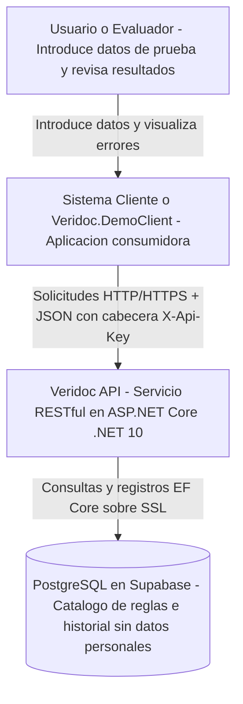
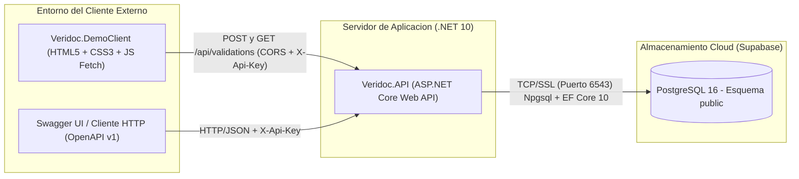
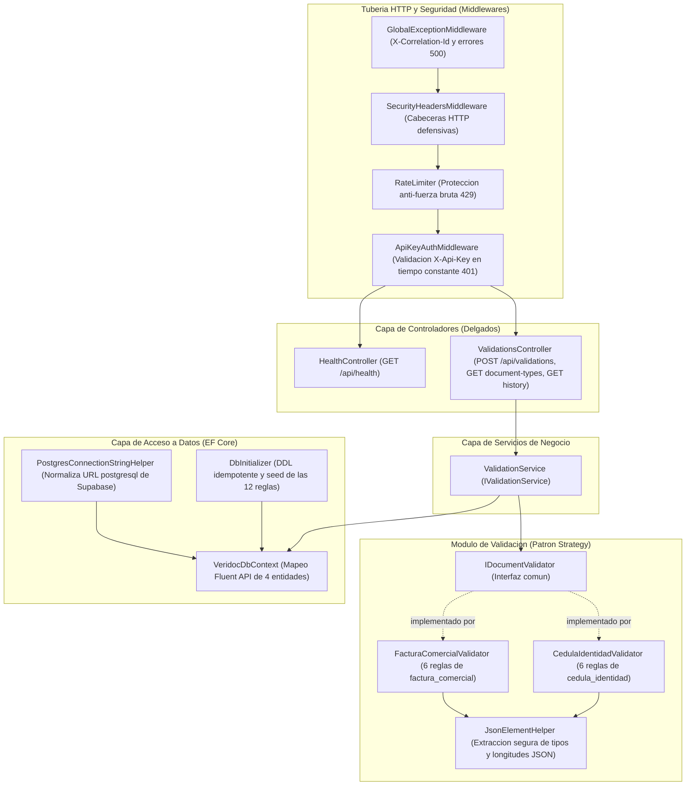
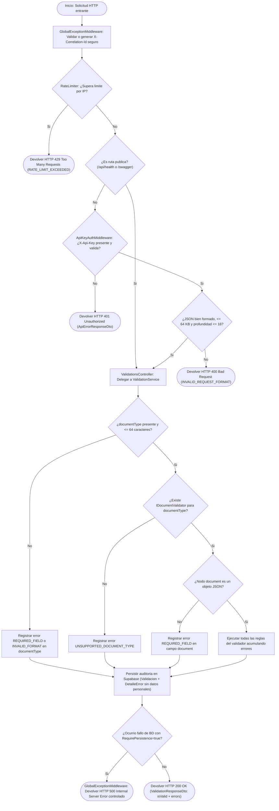
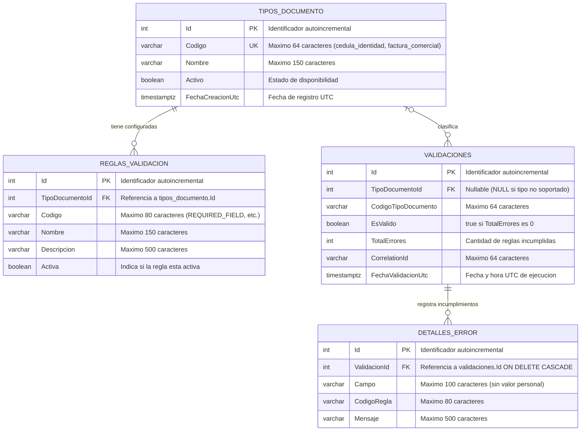

# Veridoc API — Arquitectura, Diagramas C4, Flujo y Modelo Entidad-Relación

**Proyecto:** Veridoc API (MVP)\
**Stack:** C# (.NET 10), ASP.NET Core Web API, Entity Framework Core, PostgreSQL (Supabase) y Cliente Web Ligero (HTML/CSS/JS)

> **Nota de fidelidad arquitectónica:** Todos los diagramas de este documento reflejan únicamente los componentes reales implementados y verificados en la solución `Veridoc.slnx`.

---

## 1. Diagramas C4 del Sistema

### 1.1. Nivel 1: Diagrama C4 de Contexto

Muestra cómo **Veridoc API** interactúa con sus usuarios/actores y con el almacenamiento en la nube (Supabase PostgreSQL).

---

### 1.2. Nivel 2: Diagrama C4 de Contenedores

Muestra los contenedores tecnológicos que conforman la solución completa y cómo se comunican entre sí de forma desacoplada.

---

### 1.3. Nivel 3: Diagrama C4 de Componentes (Interior de `Veridoc.API`)

Muestra la separación de responsabilidades interna del proyecto `Veridoc.API`.

---

## 2. Diagrama de Flujo de Validación Documental

Representa el recorrido completo de una solicitud desde que ingresa a `Veridoc.API` hasta que devuelve la respuesta JSON diferenciando entre **documento válido**, **documento inválido por reglas**, **solicitud mal formada (`400`)**, **no autorizada (`401`)**, **límite de peticiones (`429`)** y **error técnico (`500`)**.

---

## 3. Modelo Entidad-Relación (PostgreSQL / Supabase)

El esquema relacional implementado en `public` consta de 4 tablas diseñadas bajo el principio de **minimización de datos personales (Ley 81 de 2019 de Panamá)**:

